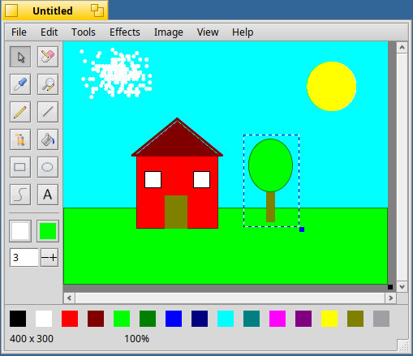
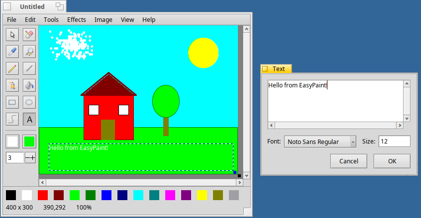
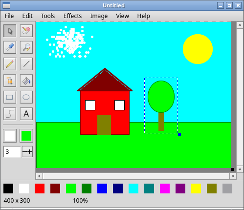

EasyPaint for Haiku
===================

EasyPaint is a simple bitmap graphics editor in the spirit of MS Paint. This
is a port of [EasyPaint](https://github.com/Gr1N/EasyPaint) (via
[clasqm/EasyPaint](https://github.com/clasqm/EasyPaint), the Qt 5 version
packaged for Haiku) to Haiku's own interface: no Qt, just the Be/Haiku API.

## Screenshots

Haiku R1/beta6: a selection around the tree, ready to move, scale or copy.

Haiku: the text tool draws on the image as you type in its window.

Linux (the AppImage, X11): the same picture drawn with the same tools.

Features
--------

- **Tools:** selection, eraser, colour picker, magnifier, pen, line, spray,
  flood fill, rectangle, ellipse, Bézier curve and text. The primary mouse
  button draws in the primary colour, the secondary button in the secondary
  colour; rectangles and ellipses drawn with the secondary button are filled.
  Control-click works as the secondary button.
- **Selections** can be moved, scaled with their corner grip, cut, copied,
  pasted and deleted; right-click one for a menu.
- **Effects:** gray, negative, binarization, gamma, Gaussian blur, sharpen,
  and a custom 3×3 convolution with a preview.
- **Image:** scale the image, resize the canvas (also by dragging the grip at
  its bottom-right corner), rotate.
- **Files:** opens and saves every format Haiku's translators handle. The
  format comes from the file's type or its extension; PNG otherwise.
- Undo and redo, zoom from 25% to 1600%, autosave, printing.

What's different from the Qt version
------------------------------------

- Each image has its own window instead of a tab; opening files from
  Tracker or the command line adds windows to the running app.
- Zooming only changes the view. The Qt version scaled the image itself.
- Keyboard shortcuts are Haiku's standard ones (Alt+S, Alt+Z, …); Alt+1 to
  Alt+0 choose the first ten tools, as Ctrl+1 to Ctrl+0 did.
- Language follows Haiku's Locale preferences. The strings are marked for
  translation, but there are no catalogs yet.
- Binarization uses luminance with a threshold of 128 (the original turned
  bright pixels black). Gaussian blur's intensity is the number of passes
  (in the original it had no effect). The custom effect starts from the
  identity kernel. The flood fill no longer recurses, so large areas can't
  overflow the stack.
- Copy and paste go through the system clipboard as `image/bitmap`, like
  ShowImage; raw image data on the clipboard can be pasted too.

Building
--------

On Haiku (R1/beta6 or newer, or Renku OS), with `haiku_devel` installed:

    make            # builds ./EasyPaint
    make test       # unit tests for the pixel code (any OS)
    make install    # copies it to ~/config/non-packaged/apps
    make hpkg       # builds easypaint-<version>-<revision>-<arch>.hpkg

The same sources build on Linux against Cosmoe (`make COSMOE_ROOT=<prefix>`),
which `.github/workflows/appimage.yml` packages as an AppImage, and cross-build
an arm64 `.hpkg` on Linux (`tools/haiku-arm64/make-sysroot.sh`, then
`make HAIKU_CROSS=1` and `packaging/build-hpkg-arm64.sh`).
`sh tools/haiku-typecheck.sh` type-checks the sources against Haiku's headers
on a Linux host. The packaging and CI files come from the beos-app-platforms
templates; `haiku-app.env` holds the app's settings for them, and
`release/test-plan.md` the checks a release must pass.

| Platform | Status |
|---|---|
| Haiku R1/beta6 x86_64 (`.hpkg`; installs on Renku OS too) | Release-tested: install, launch, draw, save as PNG and reopen, save as JPEG, quit. Also tried by hand: every tool, selections and the clipboard, the effects, the Image menu, zoom, undo, the dialogs. |
| Haiku arm64 | Not built yet |
| Linux x86_64 (AppImage) | Release-tested under X11 (Xvfb and Openbox): the same checks as on Haiku. Started under Wayland (headless sway) in CI. |
| Linux aarch64 (AppImage) | Started under X11 and Wayland on GitHub's arm64 runners; the feature checks weren't run there. |

Printing and autosave haven't been tried on any platform.

Source layout
-------------

| Path | What |
|---|---|
| `src/core/ImageOps.*` | Portable pixel code: effects, fill, scale, rotate. No Haiku headers. |
| `src/CanvasView.*` | The image view: zoom, undo history, tool dispatch, canvas grip |
| `src/Tools.*` | The drawing tools |
| `src/PaintWindow.*` | Menus, tool box, palette, status bar, saving and printing |
| `src/App.cpp` | Application, shared state, opening files |
| `src/*Window.*` | Size, effect, text, colour and settings windows |
| `EasyPaint.rdef` | Resources: signature, version, the tool icons, the app icon |
| `tools/make-icon.py` | Generates the vector app icon |

License
-------

MIT, as the original. See `LICENSE`, `AUTHORS` and `THANKS`.
